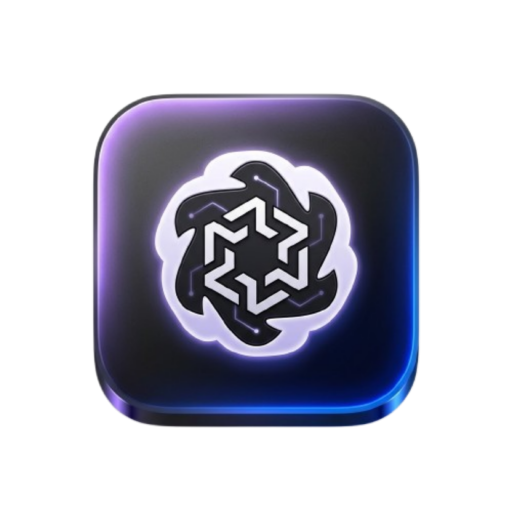

<div align="center">



# 🧠 WaveMind
### Next-Generation Cognitive Enhancement & Neural Training Super-App

[](https://github.com/Samir-Ahmmed-dev/WaveMind/releases/latest)
[](https://github.com/Samir-Ahmmed-dev/WaveMind)
[](https://github.com/Samir-Ahmmed-dev/WaveMind)
[](LICENSE)

<br/>

[📥 **Download Latest WaveMind APK (Direct Link)**](https://github.com/Samir-Ahmmed-dev/WaveMind/releases/latest/download/WaveMind.apk) &bull; [📦 **All Releases**](https://github.com/Samir-Ahmmed-dev/WaveMind/releases)

---

</div>

## 🌟 Overview

**WaveMind** is an advanced cognitive training super-app engineered with modern **Jetpack Compose**, fluid **3D glassmorphism**, and zero-latency performance. Inspired by cutting-edge interactive showcases from Google, Firebase, and GitHub, WaveMind delivers a hypnotic futuristic atmosphere powered by **Behind-the-Card 3D Radial Nebula Underglow**, silky-smooth **120 FPS high refresh rate acceleration**, and a comprehensive suite of **14 neural training games**.

Whether sharpening working memory, testing millisecond reaction speeds, or solving cryptographic puzzles, WaveMind calibrates your mental acuity with zero distractions and zero latency.

---

## ⚡ Key Highlights & Innovations

### 1. 🌌 Google & Firebase-Style 3D Behind-the-Card Underglow
- **Radial Nebula Halo**: Radiant circular energy orbs float and orbit beneath frosted translucent glass cards, casting realistic spatial depth into the surrounding environment.
- **GitHub 3D Spatial Levitation**: True physics-based elevation bobbing with dynamic perspective tilt (`rotationX` & `rotationY`) and elevation-responsive drop shadow underglow.
- **Layer Flexibility**: Fully customizable layer placement — choose between **Behind Card (3D Underglow)**, **Top Border Edge**, or **Both Layers**.
- **Aura Sizing & Tuning**: 5 fine-tuned aura spreads (**XS, SM, MD, LG, XL**) and custom color modes (Preset Neon, Cyber Theme Match, or custom Hex codes).

### 2. 🚀 120 FPS Zero-Lag Performance Engine
- **Zero-Allocation Render Passes**: Pre-cached brushes and color matrices eliminate garbage-collection stutter and frame drops completely.
- **Hardware RenderNode Acceleration**: Animations run on dedicated GPU graphics layers (`Modifier.graphicsLayer`) with zero UI-tree recompositions on frame ticks.
- **High Refresh Rate Sync**: Automatically requests hardware 120Hz/90Hz/144Hz panel modes on supported Android devices for liquid-smooth interactions.
- **Optimized Background Shaders**: Starfields, cyber grids, and CRT scanlines use cached draw passes for effortless rendering on both flagship and budget smartphones.

### 3. 🎮 14 Calibrated Cognitive Drills

| # | Drill Name | Category | Description |
|---|---|---|---|
| 1 | **Memory Grid** | Memory | Memorize and replicate neon tile patterns on expanding cyber grids |
| 2 | **Card Flipper** | Memory | Uncover and match paired cybernetic symbols with minimal turns |
| 3 | **Trail Blazer** | Memory | Trace lengthening neural pathways across spatial checkpoints |
| 4 | **Dual N-Back** | Memory | Clinical working memory exercise tracking spatial & auditory stimuli |
| 5 | **Code Breaker** | Logic | Mastermind deduction cracking encrypted 4-color security keys |
| 6 | **Number Sequence**| Logic | Calculate missing numbers in mathematical series under time pressure |
| 7 | **Spatial Spin** | Logic | Mentally rotate 3D geometric shapes to identify matching orientations |
| 8 | **Anagram Blitz** | Logic | Decrypt scrambled cybersecurity and neural vocabulary before time runs out |
| 9 | **Pattern Match** | Focus | Spot target matrix patterns against high-speed distractor noise |
| 10 | **Speed Math** | Focus | Rapid mental arithmetic calculations with countdown penalties |
| 11 | **Color Clash** | Focus | The classic Stroop effect: tap the chromatic ink color, not the word |
| 12 | **Reaction Time** | Focus | Millisecond-level neural reflex benchmark with trigger shifts |
| 13 | **Focus Flow** | Focus | Real-time multi-object ball tracking bouncing across physical walls |
| 14 | **Odd One Out** | Focus | Identify chromatic and rotational anomalies in high-speed 3x3 matrices |

---

## 🎨 Personalization & Cybernetic Themes

- **10 Futuristic Theme Engines**:
  - `Cyber Void Dark` (Deep void black with neon cyan and purple accents)
  - `iOS Liquid Glass` (Frosted ultra-translucent glass with specular rims)
  - `Dark Liquid Glass` (Smoky obsidian glass with vibrant ambient underglow)
  - `Midnight AMOLED Purple` (True-black OLED power-saving aesthetic)
  - `Emerald Aurora Matrix` (Deep matrix green glow)
  - `Solar Cyber Amber`, `Deep Ocean Azure`, and more
- **Customizable Floating Dock**:
  - iOS-style floating bottom navigation bar with auto-hide on scroll
  - Adjustable elevation, height, glass opacity, and corner radii
- **Immersive Audio Engine**:
  - Sci-Fi UI, Cyber Arcade, and Neo Synthwave interactive sound packs
  - Haptic response feedback calibrated for every click and victory

---

## 📲 Download & Installation

### Option 1: Direct APK Download (Recommended)
1. Download the latest release: [**WaveMind.apk**](https://github.com/Samir-Ahmmed-dev/WaveMind/releases/latest/download/WaveMind.apk)
2. Open the downloaded `.apk` file on your Android device.
3. If prompted, enable **Install from unknown sources** in your device settings.
4. Launch **WaveMind** and enjoy smooth 120 FPS neural training!

### Option 2: Build from Source
```bash
# Clone the repository
git clone https://github.com/Samir-Ahmmed-dev/WaveMind.git
cd WaveMind

# Build debug APK with Gradle
./gradlew :app:assembleDebug

# The compiled APK will be located at:
# app/build/outputs/apk/debug/app-debug.apk
```

---

## 🛠️ Architecture & Tech Stack

- **Language**: Kotlin 2.0+
- **UI Toolkit**: Jetpack Compose with Material 3
- **Architecture**: MVI / MVVM with Clean Architecture principles
- **Reactive State**: Kotlin Coroutines & StateFlow
- **Storage**: Jetpack DataStore Preferences & Room Database
- **Graphics & Motion**: Compose Graphics Layer, DrawScope Canvas, Hardware RenderNode Acceleration
- **CI/CD**: Automated GitHub Actions APK build & release pipeline

---

## 📄 License

Licensed under the [Apache License, Version 2.0](LICENSE).  
Copyright © 2026 Samir Ahmmed. All rights reserved.
